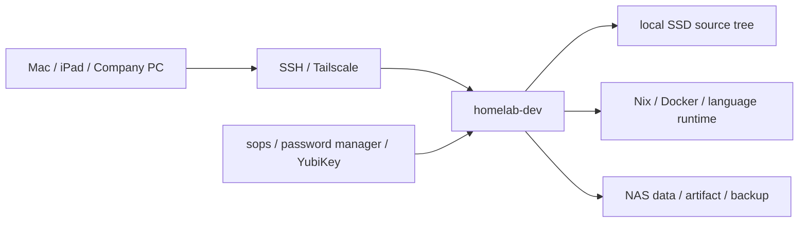
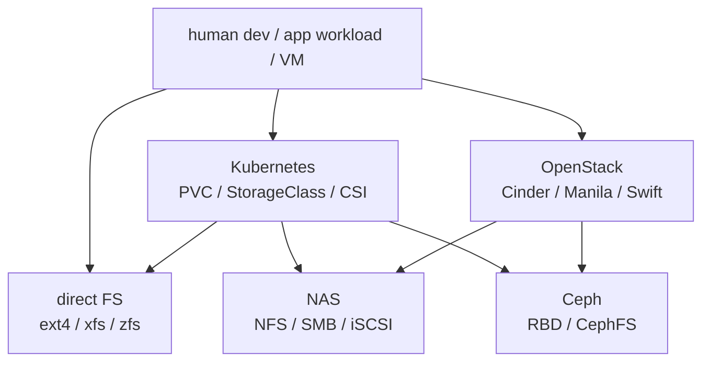

# Mac 개발환경 Homelab 이관

> [!NOTE]
> 
> 개발환경 뿐만 아니라 OCI,AWS 와 접속하는 것도 신경써야한다
> 결국 회사 들어가면 인프라는 OCI/AWS 에 있을테니 말이다
> 따라서 OCI/AWS 접속을 위해서는 최종적으로
> 오주석 전임님이 말씀주신 아이디어를 빌려서 `OCI/AWS 와 SiteToSiteVPN 을 통해 보안망을 우회하여 집에서도 접속할 수 있게` 하여
> 어디서든 YubiKey 와 tailnet 만 구성되어있다면 개발환경과 OCI/AWS 에 접속할 수 있을 것이다
> 이를 통해 내 개인 에이전트를 그 위에 돌리거나 개발을 하거나 할 수 있을 것이다

> [!NOTE]
> 
> TL;DR;
> 짧고 굵게 궁금한 것과 핵심만 아래와 같이 정리해보았다
> ## 1. Mac의 `~/dev`에 있는 repo들을 homelab으로 어떻게 옮길까?
> 
> * **짧은 답**
> 
>   * Git remote가 있는 repo는 homelab에서 **fresh clone**.
>   * Mac에만 있는 dirty/untracked 변경만 `rsync` 등으로 별도 이동.
>   * 이후 `homelab-dev:~/workspace`를 active source of truth로 사용.
>   * Mac clone은 offline/fallback 용도로만 유지.
> 
> * **핵심**
> 
>   * repo directory 복사보다 `source / runtime / data / secret`의 lifecycle을 분리하는 것이 중요하다.
> 
> * **Official docs**
> 
>   * [Git — git clone](https://git-scm.com/docs/git-clone)
>   * [Git — git status](https://git-scm.com/docs/git-status)
>   * [Git — git bundle](https://git-scm.com/docs/git-bundle)
> 
> 
> ## 2. 임의의 Tailscale PC에 YubiKey만 연결하면 `homelab-dev`에 SSH할 수 있을까?
> 
> * **짧은 답**
> 
>   * 구성 가능하지만 **YubiKey만 꽂는 것으로 끝나지는 않는다.**
>   * Client가 tailnet에 접근 가능해야 하고 OpenSSH가 FIDO2를 지원해야 한다.
>   * `Tailscale network + normal OpenSSH + YubiKey FIDO2 resident key` 조합이 명확하다.
> 
> * **역할 분리**
> 
>   * Tailscale → 해당 device가 `homelab-dev:22`까지 갈 수 있는가.
>   * YubiKey → SSH 사용자에게 실제 hardware credential이 있는가.
> 
> * **주의**
> 
>   * `Tailscale SSH` 자체는 일반 `authorized_keys + YubiKey SSH key`와 다른 authentication model이다.
>   * YubiKey가 있다고 해서 arbitrary/untrusted PC 자체가 안전해지는 것은 아니다.
> 
> * **Official docs**
> 
>   * [Yubico — Securing SSH with FIDO2](https://developers.yubico.com/SSH/Securing_SSH_with_FIDO2.html)
>   * [Tailscale — Tailscale SSH](https://tailscale.com/docs/features/tailscale-ssh)
>   * [Tailscale — Device Approval](https://tailscale.com/docs/features/access-control/device-management/device-approval)
>   * [Tailscale — Access Control](https://tailscale.com/docs/features/access-control)
> 
> 
> ## 3. Active source tree를 NFS에 두는 것은 왜 별로인가?
> 
> * **짧은 답**
> 
>   * NFS가 위험한 것이 아니라 **Git/LSP/build가 계속 접근하는 hot workspace에 적합하지 않은 것**에 가깝다.
> 
> * **이유**
> 
>   * network latency + metadata/attribute caching.
>   * Git, LSP, watcher, package manager는 작은 파일에 매우 빈번하게 접근한다.
>   * NAS/network 장애가 shell/build/IDE의 filesystem 장애로 바로 전파된다.
>   * UID/GID, locking, caching semantics도 고려해야 한다.
>   * `sec=sys`만 사용하면 identity/security도 강하지 않다.
> 
> * **적합한 용도**
> 
>   * dataset
>   * artifact
>   * backup
>   * shared files
> 
> * **Official docs**
> 
>   * [Linux — nfs(5)](https://man7.org/linux/man-pages/man5/nfs.5.html)
>   * [Kubernetes — Volumes / NFS](https://kubernetes.io/docs/concepts/storage/volumes/)
> 
> 
> ## 4. 동일 K8s cluster의 별도 namespace에 있는 IdP를 dev 환경에 사용할 수 있을까?
> **여기서 말하는 IdP 는 Identity Provider 이다. OIDC 기반 Dex,Okta,Keycloak 등등,,,
> **도움이 될까하여 [OIDC 핸즈온 실습 블로그](https://lakescript.net/entry/kubernetes-%EC%9D%B8%EC%A6%9D%EC%9D%B8%EA%B0%80-OIDC-%EB%A1%9C%EC%BB%AC-%ED%99%98%EA%B2%BD-%EC%8B%A4%EC%8A%B5) 도 링크로 남겨본다
> 
> * **짧은 답**
> 
>   * **가능하며 자연스러운 구조다.**
> 
> ```text
> Kubernetes
> ├── identity namespace
> │   └── Keycloak / Dex / Authentik
> │
> ├── access namespace
> │   └── identity-aware proxy
> │
> └── dev namespace
>     └── code-server / dev environment
> ```
> 
> * Namespace 간 Service 접근은 Kubernetes DNS를 통해 가능하다.
> 
> * OIDC issuer는 `*.svc.cluster.local`보다 외부에서도 일관된 canonical HTTPS hostname을 사용하는 편이 좋다.
> 
> * Namespace 자체는 security boundary가 아니므로 `NetworkPolicy`를 함께 사용한다.
> 
> * IdP와 dev가 같은 cluster에 있으면 **cluster failure가 authentication failure까지 동시에 일으킨다는 점**은 고려해야 한다.
> 
> * SSH + YubiKey 같은 별도 break-glass path를 유지하는 것이 좋다.
> 
> * **Official docs**
> 
>   * [Kubernetes — Namespaces](https://kubernetes.io/docs/concepts/overview/working-with-objects/namespaces/)
>   * [Kubernetes — Network Policies](https://kubernetes.io/docs/concepts/services-networking/network-policies/)
>   * [Kubernetes — Authentication / OIDC](https://kubernetes.io/docs/reference/access-authn-authz/authentication/)
>   * [Cloudflare Access — Applications](https://developers.cloudflare.com/cloudflare-one/access-controls/applications/http-apps/)
> 
> 
> ## 5. `local-path`보다 Ceph가 더 scalable하지 않은가?
> 
> * **짧은 답**
> 
>   * **Storage scalability 관점에서는 맞다.**
>   * 하지만 VM 여러 개가 하나의 physical host 위에 있다면 실제 hardware failure domain은 하나뿐이다.
> 
> * **local-path**
> 
>   * 단순함.
>   * 빠름.
>   * 특정 node에 volume이 묶임.
>   * node-independent workload migration에는 불리함.
> 
> * **Ceph**
> 
>   * 여러 physical host에 data replica를 배치할 수 있음.
>   * node-independent block/filesystem storage 제공 가능.
>   * 대신 운영 complexity와 network/disk 비용이 커짐.
> 
> * **판단**
> 
>   * `3 VMs on 1 physical server ≠ 3 failure domains`.
>   * 실제 physical node가 여러 대일 때 Ceph의 장점이 커진다.
> 
> * **Official docs**
> 
>   * [Kubernetes — Persistent Volumes](https://kubernetes.io/docs/concepts/storage/persistent-volumes/)
>   * [Kubernetes — Storage Classes](https://kubernetes.io/docs/concepts/storage/storage-classes/)
>   * [Ceph — CRUSH Maps](https://docs.ceph.com/en/latest/rados/operations/crush-map/)
>   * [Ceph — Hardware Recommendations](https://docs.ceph.com/en/latest/start/hardware-recommendations/)
>   * [Ceph CSI](https://github.com/ceph/ceph-csi)
> 
> 
> ## 6. Linux의 `filesystem + process + PTY` 모델을 Kubernetes에서는 어떻게 구현하는가?
> 
> * **짧은 답**
> 
>   * Kubernetes가 이 모델을 대체하는 것이 아니다.
>   * **같은 Linux model을 container namespace 안에서 사용하면서 storage mounting과 process placement를 Kubernetes가 관리한다.**
> 
> ```text
> Terminal
>    ↓
> PTY
>    ↓
> shell process
>    ↓
> container mount namespace
>    ↓
> /workspace
>    ↓
> PVC
>    ↓
> CSI
>    ↓
> storage
> ```
> 
> * `kubectl exec -it`도 결국 container 내부 shell process에 stdin/TTY를 붙이는 것이다.
> 
> * `/workspace` 역시 container 내부에서는 평범한 POSIX filesystem으로 보인다.
> 
> * **Official docs**
> 
>   * [Kubernetes — Persistent Volumes](https://kubernetes.io/docs/concepts/storage/persistent-volumes/)
>   * [kubectl exec](https://kubernetes.io/docs/reference/kubectl/generated/kubectl_exec/)
> 
> 
> ## 7. Kubernetes 기반 dev workspace는 실제로 어떤 형태인가?
> 
> * **짧은 답**
> 
>   * 개발 shell/LSP/editor backend는 Pod에 존재.
>   * repo들은 PVC에 존재.
>   * Pod와 filesystem의 lifecycle을 분리할 수 있다.
> 
> ```text
> Dev Workspace Pod
> │
> ├── bash / zsh
> ├── git
> ├── LSP
> ├── compiler
> │
> └── /workspace
>         │
>        PVC
>         │
>       Ceph RBD
> ```
> 
> * Pod가 죽어도 PVC는 남길 수 있다.
> 
> * 새 Pod에서 같은 PVC를 mount해 filesystem을 다시 사용할 수 있다.
> 
> * 단, shell/tmux/LSP 같은 **process state까지 살아남는 것은 아니다.**
> 
> * **Official docs**
> 
>   * [Kubernetes — Persistent Volumes](https://kubernetes.io/docs/concepts/storage/persistent-volumes/)
>   * [Ceph CSI](https://github.com/ceph/ceph-csi)
> 
> 
> ## 8. Ceph RBD와 CephFS의 차이는?
> 
> * **짧은 답**
> 
> ```text
> RBD    = distributed virtual block device
> CephFS = distributed POSIX filesystem
> ```
> 
> ### RBD
> 
> ```text
> Ceph
>  ↓
> RBD
>  ↓
> /dev/rbdX
>  ↓
> ext4 / xfs
>  ↓
> /workspace
> ```
> 
> * 한 workspace에 하나의 virtual disk를 주는 모델과 잘 맞는다.
> * 일반 Linux disk와 사고방식이 비슷하다.
> 
> ### CephFS
> 
> ```text
> CephFS
>  ├── client A
>  ├── client B
>  └── client C
> ```
> 
> * 여러 client가 동일 filesystem namespace를 공유할 때 유리하다.
> 
> * **Official docs**
> 
>   * [Ceph — RBD](https://docs.ceph.com/en/latest/rbd/)
>   * [Ceph — CephFS](https://docs.ceph.com/en/latest/cephfs/)
>   * [Ceph — Mount CephFS with kernel driver](https://docs.ceph.com/en/latest/cephfs/mount-using-kernel-driver/)
> 
> 
> ## 9. Source / Data / Artifact를 왜 분리하는가?
> 
> * **짧은 답**
> 
>   * 저장 장치를 반드시 물리적으로 나누자는 것이 아니라 **lifecycle과 backup policy를 분리하자는 의미다.**
> 
> ### Source
> 
> ```text
> /workspace
> ├── repo
> ├── .git
> ├── node_modules
> ├── build cache
> └── LSP index
> ```
> 
> * 자주 읽고 쓴다.
> * 상당 부분 Git/package manager로 재생성 가능하다.
> 
> ### Data
> 
> ```text
> /data
> ├── database
> ├── uploaded files
> └── datasets
> ```
> 
> * Git clone으로 복구되지 않는다.
> * persistence/backup이 중요하다.
> 
> ### Artifact
> 
> ```text
> artifacts
> ├── binary
> ├── container image
> ├── release tarball
> └── generated output
> ```
> 
> * source에서 다시 생성 가능한 경우가 많다.
> * retention policy가 source와 다르다.
> * object storage가 더 적합한 경우가 많다.
> 
> ### 같은 Ceph cluster를 사용해도 된다
> 
> ```text
> Ceph
> ├── RBD → workspace / DB volumes
> ├── CephFS → shared dataset
> └── RGW → artifacts/object storage
> ```
> 
> 즉 **physical backend가 같아도 logical lifecycle은 분리할 수 있다.**
> 
> * **Official docs**
> 
>   * [Ceph — RBD](https://docs.ceph.com/en/latest/rbd/)
>   * [Ceph — CephFS](https://docs.ceph.com/en/latest/cephfs/)
>   * [Ceph — Object Gateway](https://docs.ceph.com/en/latest/radosgw/)
> 
> 
> ## 10. Ceph에 분산 저장된 파일은 어떻게 export/migrate하는가?
> 
> * **짧은 답**
> 
>   * OSD node에 직접 들어가서 object를 복사하지 않는다.
>   * **Ceph가 제공하는 client abstraction을 mount/map한 다음 평범한 filesystem처럼 복사한다.**
> 
> ### CephFS
> 
> ```text
> Ceph
>  ↓
> CephFS mount
>  ↓
> /mnt/ceph
> ```
> 
> 그 뒤 평범하게:
> 
> ```bash
> rsync -aHAX /mnt/ceph/ destination:/data/
> ```
> 
> ### RBD
> 
> ```text
> Ceph
>  ↓
> RBD map
>  ↓
> /dev/rbdX
>  ↓
> mount
>  ↓
> /mnt/workspace
> ```
> 
> 그 뒤:
> 
> ```bash
> rsync -aHAX /mnt/workspace/ destination:/workspace/
> ```
> 
> ### Kubernetes 내부라면
> 
> ```text
> Migration Pod
> ├── /source ← old PVC
> └── /dest   ← new PVC
> ```
> 
> 후:
> 
> ```bash
> rsync -aHAX /source/ /dest/
> ```
> 
> * **Official docs**
> 
>   * [Ceph — RBD Quick Start](https://docs.ceph.com/en/latest/start/quick-rbd/)
>   * [Ceph — Mount CephFS](https://docs.ceph.com/en/latest/cephfs/mount-using-kernel-driver/)
>   * [Kubernetes — Persistent Volumes](https://kubernetes.io/docs/concepts/storage/persistent-volumes/)
> 
> 
> ## 11. CephFS를 일반 Mac/Linux client에 NFS처럼 export할 수도 있는가?
> 
> * **짧은 답**
> 
>   * 가능하다.
>   * CephFS를 NFS-Ganesha를 통해 NFS export할 수 있다.
> 
> ```text
> CephFS
>   ↓
> NFS-Ganesha
>   ↓
> NFS
>  ├── Mac
>  └── Linux
> ```
> 
> * 다만 interactive source workspace를 다시 Mac에 NFS mount해 직접 개발하면 remote-first architecture의 장점을 상당 부분 잃는다.
> 
> * **Official docs**
> 
>   * [Ceph — NFS / NFS-Ganesha](https://docs.ceph.com/en/latest/mgr/nfs/)
> 
> 
> ## 12. Node가 죽으면 Ceph volume도 바로 다른 node에서 이어서 쓰면 되는가?
> 
> * **짧은 답**
> 
>   * **아니다. Failover라기보다 crash recovery다.**
> 
> ```text
> Node A crash
>    ↓
> old writer fencing
>    ↓
> RBD reattach
>    ↓
> filesystem journal recovery
>    ↓
> application recovery
>    ↓
> service restart
> ```
> 
> * Ceph는 storage가 node와 함께 사라지지 않도록 해주는 것이지 process state를 보존하지 않는다.
> 
> * `fsync()` 이전의 page cache write는 손실될 수 있다.
> 
> * filesystem은 ext4/xfs journal recovery를 수행한다.
> 
> * **Official docs**
> 
>   * [Ceph — RBD](https://docs.ceph.com/en/latest/rbd/)
>   * [Ceph — RBD Exclusive Locks](https://docs.ceph.com/en/latest/rbd/rbd-exclusive-locks/)
> 
> 
> ## 13. Node failure 시 DB의 WAL은 어떻게 되는가?
> 
> * **짧은 답**
> 
>   * WAL은 오히려 **crash recovery를 위해 존재한다.**
>   * 중요한 것은 storage가 `fsync()` durability semantics를 올바르게 보장하는 것이다.
> 
> ```text
> COMMIT
>  ↓
> WAL write
>  ↓
> fsync
>  ↓
> filesystem
>  ↓
> RBD
>  ↓
> Ceph replicas
> ```
> 
> Crash 이후:
> 
> ```text
> filesystem recovery
>  ↓
> PostgreSQL start
>  ↓
> WAL replay
>  ↓
> consistent state
> ```
> 
> * **Official docs**
> 
>   * [PostgreSQL — WAL Introduction](https://www.postgresql.org/docs/current/wal-intro.html)
>   * [PostgreSQL — WAL Configuration](https://www.postgresql.org/docs/current/runtime-config-wal.html)
> 

> 
> ## 14. 진짜 위험한 것은 node death보다 network partition인가?
> 
> * **짧은 답**
> 
>   * 그렇다.
>   * 기존 node가 죽은 것으로 판단되어 새 writer가 생성됐는데 old node가 다시 write하면 split-brain/corruption 위험이 있다.
> 
> ```text
>        Ceph
>       /    \
>  old node  new node
>     │         │
>  writer A   writer B
> ```
> 
> 이를 막기 위해 storage-level **fencing**이 필요하다.
> 
> * Ceph RBD에는 exclusive lock과 client blocklisting 기능이 있다.
> 
> * old client를 차단한 후 새로운 writer가 volume을 가져가야 한다.
> 
> * **Official docs**
> 
>   * [Ceph — RBD Exclusive Locks](https://docs.ceph.com/en/latest/rbd/rbd-exclusive-locks/)
> 
> 
> ## 15. Kubernetes의 `ReadWriteOnce`만으로 single writer가 보장되는가?
> 
> * **짧은 답**
> 
>   * 완전히 그렇지는 않다.
>   * `ReadWriteOnce`는 기본적으로 **single node** 접근 의미다.
>   * 엄격한 single Pod writer라면 `ReadWriteOncePod`가 더 적절하다.
> 
> ```text
> RWOP
>  ↓
> Kubernetes scheduling protection
> 
> CSI attach/detach
>  ↓
> volume lifecycle protection
> 
> Ceph fencing
>  ↓
> storage writer protection
> 
> DB WAL
>  ↓
> application consistency
> ```
> 
> 각각 다른 계층의 protection이다.
> 
> * **Official docs**
> 
>   * [Kubernetes — Persistent Volume Access Modes](https://kubernetes.io/docs/concepts/storage/persistent-volumes/)
>   * [Kubernetes — ReadWriteOncePod](https://kubernetes.io/docs/tasks/administer-cluster/change-pv-access-mode-readwriteoncepod/)
> 
> 
> ## 16. DB HA도 하나의 Ceph RBD를 다른 node에서 다시 붙이면 되는가?
> 
> * **짧은 답**
> 
>   * recovery 방법은 될 수 있지만 **DB HA의 primary strategy로 보기는 어렵다.**
> 
> 보다 일반적인 구조:
> 
> ```text
> PostgreSQL A
>     │
>  replication
>     ▼
> PostgreSQL B
> 
> RBD A           RBD B
> ```
> 
> * DB-native replication
> * WAL archive
> * backup/PITR
> 
> 를 application-level recovery mechanism으로 사용하고 Ceph는 underlying durable storage 역할을 담당한다.
> 
> * **Official docs**
> 
>   * [PostgreSQL — High Availability / Replication](https://www.postgresql.org/docs/current/high-availability.html)
>   * [PostgreSQL — Continuous Archiving and PITR](https://www.postgresql.org/docs/current/continuous-archiving.html)
> 
> 
> ## 17. 테더링이란?
> 
> * **짧은 답**
> 
>   * 휴대폰의 LTE/5G 연결을 laptop이 Wi-Fi/USB 등으로 빌려 쓰는 것이다.
>   * 이 경우 회사 LAN/방화벽/DNS를 통하지 않는다.
> 
> ```text
> Laptop
>   ↓
> Phone hotspot
>   ↓
> LTE / 5G
>   ↓
> Internet
> ```
> 
> 따라서 회사망에서 차단된 서비스가 mobile network에서는 접근 가능할 수 있다.
> 
> 
> ## 18. Tailscale을 테더링에서 인증한 후 회사망으로 돌아오면 왜 일부 통신이 남을 수 있는가?
> 
> * **짧은 답**
> 
>   * Tailscale은 **control plane과 data plane을 분리**한다.
>   * 이미 device identity, keys, peer information을 받은 상태라면 control plane connectivity가 끊겨도 기존 peer communication이 잠시 유지될 수 있다.
>   * 하지만 coordination/key refresh가 불가능해지므로 정상적인 장기 운영 방법은 아니다.
> 
> ```text
> Control plane
>   authentication / peer discovery / policy
> 
> Data plane
>   WireGuard peer-to-peer traffic
> ```
> 
> * 회사가 의도적으로 Tailscale endpoint를 차단한 경우 이를 우회해서 사용하는 것은 기술 가능성과 별개로 사내 정책 문제가 있다.
> 
> * **Official docs**
> 
>   * [Tailscale — Control and Data Planes](https://tailscale.com/docs/concepts/control-data-planes)
>   * [Tailscale — Coordination Server Connectivity](https://tailscale.com/docs/reference/coordination-server-down)
> 
> 
> ## 19. Site-to-Site VPN이란?
> 
> * **짧은 답**
> 
>   * client 한 대가 VPN에 접속하는 것이 아니라 **network A와 network B의 gateway를 연결하는 VPN**이다.
> 
> ```text
> Home LAN
>    │
> Home VPN Gateway
>    ║
>    ║ IPsec
>    ║
> OCI DRG
>    │
> OCI VCN
> ```
> 
> 예:
> 
> ```text
> Home: 192.168.10.0/24
> OCI:  10.100.0.0/16
> ```
> 
> 두 network 사이에 routing이 생긴다.
> 
> * **Official docs**
> 
>   * [Oracle Cloud — Site-to-Site VPN](https://docs.oracle.com/en-us/iaas/Content/Network/Tasks/overviewIPsec.htm)
>   * [Oracle Cloud — Managing Site-to-Site VPN](https://docs.oracle.com/en-us/iaas/Content/Network/Tasks/ipsec-manage.htm)
> 
> 
> ## 20. Home ↔ OCI Site-to-Site VPN을 만들면 회사 PC도 자동으로 home에 접근 가능한가?
> 
> * **짧은 답**
> 
>   * **아니다.**
> 
> ```text
> Home ═══ IPsec ═══ OCI
> 
> Company PC → ?? → OCI
> ```
> 
> Home과 OCI network만 연결된 것이다.
> 
> 회사 PC가 OCI private network로 들어오는 별도의 승인된 경로가 있어야:
> 
> ```text
> Company PC
>     ↓
>    OCI
>     ↓
> Site-to-Site VPN
>     ↓
>   Home
> ```
> 
> 이 가능하다.
> 
> 따라서 `Site-to-Site VPN`과 `client VPN / remote access VPN`을 구분해야 한다.
> 
> 그리고 회사에서 특정 tunneling service를 의도적으로 차단하는 경우 **개인 OCI를 relay/tunnel endpoint로 사용해 이를 우회하는 것은 사내 보안 정책 위반이 될 수 있으므로 승인된 접근 방식인지 먼저 확인해야 한다.**
> 
> * **Official docs**
> 
>   * [Oracle Cloud — Site-to-Site VPN](https://docs.oracle.com/en-us/iaas/Content/Network/Tasks/overviewIPsec.htm)
> 
> 
> # Current Architecture Direction
> 
> 현재 논의를 압축하면 다음처럼 볼 수 있다.
> 
> ```text
>                        Remote Client
>                             │
>                     approved network/auth
>                             │
>                             ▼
>                   Dev Workspace / Host
>                             │
>                     /workspace filesystem
>                             │
>              ┌──────────────┴──────────────┐
>              │                             │
>        Simple stage                  Scaled stage
>              │                             │
>         local NVMe                     Ceph RBD
>                                            │
>                               multiple physical hosts
> 
> 
> Kubernetes
> ├── identity namespace
> │   └── OIDC IdP
> │
> ├── access namespace
> │   └── identity-aware proxy
> │
> ├── dev namespace
> │   └── workspace Pod
> │        └── workspace PVC → RBD
> │
> └── application state
>      ├── DB PVC → RBD
>      ├── shared data → CephFS
>      └── artifact → RGW / object storage
> ```
> 
> 핵심 원칙은 다음 네 가지다.
> 
> 1. **Kubernetes도 결국 Linux process + filesystem + PTY 모델이다.**
> 2. **Pod lifecycle과 persistent filesystem lifecycle을 분리한다.**
> 3. **Source / mutable data / artifact는 서로 다른 recovery·retention lifecycle을 가진다.**
> 4. **Ceph는 장애를 없애는 것이 아니라 storage를 node lifecycle에서 분리한다.**


# Why?

Mac 하나에 개발환경이 묶여 있으면 처음에는 편하다. 문제는 개발 장비가 하나가 아닐 때 시작된다. iPad로 급하게 접속해야 할 때, 회사 장비에서 개인 repo를 확인해야 할 때, 새 Mac에서 같은 toolchain을 다시 맞춰야 할 때 매번 같은 설정을 반복하게 된다.

필자의 목표는 Mac을 버리는 것이 아니다. Mac은 좋은 client로 남기고, 실제 checkout, build, test, editor server, long-running session을 homelab 쪽으로 옮기는 것이다.

그런데 막상 옮기려 하니 단순히 `scp -r ~/dev homelab:`로 끝나는 문제가 아니었다.

- repo는 어디에 두어야 하는가.
- NAS에 source tree를 두어도 되는가.
- Kubernetes cluster를 개발 workspace처럼 써도 되는가.
- OpenStack, Ceph, NAS, direct filesystem은 같은 레벨의 선택지인가.
- 회사 장비에는 SSH key와 secret을 어디까지 남겨도 되는가.
- NixOS에서 실행되지 않는 vendor binary는 어떻게 처리해야 하는가.

답은 storage backend 하나에 있지 않다. 개발환경을 source, runtime, data, secret으로 나누고, 각 책임에 맞는 위치를 정해야 한다.

이 글은 Mac 중심 개발환경을 homelab 중심 개발환경으로 옮길 때 필요한 판단 기준을 정리한다. 먼저 이미 비슷한 문제를 해결한 remote development 사례를 확인하고, 그 위에서 storage와 runtime 옵션을 비교한다. 마지막에는 실제 migration 절차와 TODO를 repo 단위로 정리한다.

# Things To Consider

## 먼저 시도한 사람들이 남긴 공통 패턴 🧭

어디서든 개발 가능한 환경을 만들려면 개인 장비가 바뀌어도 개발 상태가 유지되어야 한다. 이에 따라 homelab dev server, client-server development environment, travel/emergency remote dev, managed remote workspace 사례를 확인하고자 했다.

사례마다 구현은 달랐다. 어떤 글은 오래된 노트북을 개발 서버로 사용했고, 어떤 글은 browser IDE와 remote Docker를 조합했으며, 어떤 글은 identity-aware access 뒤에 remote workspace를 배치했다. 확인 결과 반복되는 구조는 같았다. source tree와 build/test runtime은 remote Linux filesystem 근처에 있고, client는 SSH, browser, native IDE UI를 담당한다.

| 사례 | 선택한 구조 | 이 글에 반영한 판단 |
| --- | --- | --- |
| Development Server Beside The Router | Linux server + Ethernet + Tailscale/MagicDNS + VS Code Remote SSH + tmux | Mac은 client이고 Linux server가 실행 환경이다.[^dev-server-router] |
| Client-Server development environment | SSH + tmux + remote VS Code, local mount는 보조 옵션 | 연결이 끊겨도 session을 복구하는 terminal layer가 필요하다.[^client-server-dev] |
| Home Lab remote setup | VS Code Remote SSH + LXD 기반 격리 환경 | 외부 코드를 실행하는 개발환경은 host와 분리해야 한다.[^homelab-dev-setup] |
| Remote dev for travel | browser-accessible IDE + remote Docker + Tailscale | iPad와 임시 노트북은 full workstation보다 emergency access에 적합하다.[^travel-remote-dev] |
| Cloudflare remote dev | identity-aware access + VS Code Remote SSH + port forwarding | remote dev는 인증, revoke, tunnel 정책을 먼저 설계해야 한다.[^cloudflare-remote-dev] |
| Coder low-latency remote dev | native/web IDE를 remote workspace에 연결 | remote desktop보다 Remote SSH/Gateway 방식이 latency에 유리하다.[^coder-latency] |

이 표에서 중요한 항목은 도구 이름이 아니다. 반복되는 판단은 source와 runtime을 remote machine 가까이에 두고, client는 입력과 화면만 담당하게 만드는 것이다. 이에 따라 이 문서의 기본 방향도 SSH thin-client와 remote-first workspace로 둔다.

## 개발환경은 repo 디렉터리 하나가 아니다 🧩

처음에는 개발환경 이관을 repo 디렉터리를 옮기는 문제로 보기 쉽다. 이에 따라 `scp`, `rsync`, NAS mount 같은 파일 이동 방법을 먼저 떠올리게 된다.

확인해보면 실제 개발에는 파일보다 더 많은 상태가 들어간다. editor server, language server index, build cache, package manager cache, container runtime, preview port, secret restore 경로가 함께 필요하다. 따라서 repo를 옮기는 것과 개발환경을 옮기는 것은 같은 작업이 아니다.



`Client` 노드는 화면, 키보드, browser, native IDE UI를 담당한다. `Dev` 노드에서는 Git checkout, LSP indexing, build, test, container 실행이 처리된다. `Source`와 `Data`를 분리하는 지점에서 active workspace와 backup 대상의 lifecycle이 달라진다.

> [!IMPORTANT]
> **Source of truth**
>
> active repo의 기준 위치는 homelab의 local SSD workspace다. Mac local clone은 offline 또는 GUI 예외 경로로만 사용한다.

## source와 data를 같은 filesystem에 두지 않는다 💾

source tree는 작은 파일이 많고 변경 빈도가 높다. Git status, language server, file watcher, dependency install, build cache가 같은 경로를 반복해서 읽고 쓴다. 이에 따라 active source tree는 latency와 filesystem semantics의 영향을 직접 받는다.

반대로 artifact, dataset, backup은 source tree와 다른 성격을 가진다. 파일 크기가 크고, 변경 빈도가 낮으며, 여러 장비에서 읽는 요구가 더 중요하다. 이 데이터는 NAS/NFS에 두는 것이 자연스럽다.

| Kind | 위치 | 이유 |
| --- | --- | --- |
| active source | dev host/VM local SSD | Git, LSP, watcher, build cache가 반복 접근한다. |
| large data | NAS/NFS | source lifecycle과 다르고 여러 장비에서 읽는다. |
| artifact | NAS/NFS or object storage | 재생성 가능하거나 보존 정책이 source와 다르다. |
| backup | NAS/restic/snapshot | restore 기준이 필요하다. |
| secret | sops/password manager/YubiKey | 복사하지 않고 복원한다. |

확인 결과 NAS는 source workspace의 기본 위치가 아니라 data, artifact, backup 계층에 더 적합하다. 따라서 `~/workspace` 아래에 NAS를 mount하지 않고, `~/data`, `~/artifacts`, `~/backup-restore` 같은 source-external path에 둔다.

## SSH thin-client는 접속 방식이 아니라 운영 경계다 🔐

Mac, iPad, 회사 장비를 모두 개발 client로 사용하려면 장비마다 동일한 secret과 toolchain을 설치하지 않아야 한다. 이에 따라 client는 SSH 접속과 화면 표시를 담당하고, 실제 개발 상태는 remote dev host가 보유하는 구조를 선택하고자 했다.

VS Code Remote SSH와 JetBrains Gateway는 remote server에 접속해 editor backend를 실행하는 방식을 제공한다.[^vscode-remote-ssh][^jetbrains-gateway] 이 구조에서는 language server와 terminal이 remote filesystem을 기준으로 동작한다. local machine은 editor UI와 forwarded port를 소비한다.

| Client | 기본 역할 | 주의점 |
| --- | --- | --- |
| Mac | primary client, native IDE UI, browser preview | local clone은 예외 경로로 제한한다. |
| iPad/iPhone | SSH terminal, emergency edit, deploy 확인 | full IDE 경험으로 정의하지 않는다. |
| company laptop | SSH client or browser-only access | durable personal key와 token을 저장하지 않는다. |

확인 결과 remote development의 핵심은 "어디서 접속할 수 있는가"보다 "잃어버린 client를 어떻게 revoke 하는가"에 있다. 따라서 YubiKey/FIDO2 SSH, Tailscale device approval, tailnet ACL, lost-device revoke 절차를 baseline에 포함한다.[^tailscale-ssh]

## latency와 port forwarding은 별도 요구사항이다 🌐

remote development는 접속만 된다고 끝나지 않는다. 입력 latency, file indexing latency, preview port 접근 방식이 매일의 개발 UX를 결정한다. 이에 따라 remote desktop보다 Remote SSH/Gateway를 우선하고, preview port를 local browser에서 볼 수 있는 tunnel 정책을 정해야 한다.

Cloudflare 사례는 remote workspace 접근에서 identity-aware access와 port forwarding을 함께 다룬다.[^cloudflare-remote-dev] VS Code Remote SSH도 remote port forwarding을 개발 workflow의 일부로 제공한다.[^vscode-port-forward] 이 구조에서는 app server를 public bind로 열지 않고, remote host의 `127.0.0.1` 또는 cluster 내부 service를 forwarded port로 확인한다.

| 항목 | 잘못된 기본값 | 권장 기본값 |
| --- | --- | --- |
| editor | remote desktop | Remote SSH/Gateway |
| preview app | `0.0.0.0` public bind | `127.0.0.1` + forwarded port |
| long build | local terminal | `tmux`/`zellij` session |
| mobile terminal | plain SSH only | reconnect 가능한 session |

이 기준을 적용하면 remote dev host는 단순 SSH endpoint가 아니다. editor backend, terminal session, preview tunnel, runtime process가 함께 움직이는 실행 지점이다.

## NixOS unsupported binary는 escape hatch가 필요하다 🧰

homelab dev host가 NixOS라면 대부분의 개발환경은 flake와 devShell로 정리하는 것이 맞다. 문제는 upstream installer가 일반 Linux FHS layout을 가정하거나, language tool이 prebuilt dynamic binary를 내려받는 경우다.

이에 따라 NixOS에서 실행되지 않는 binary를 어떻게 처리할지 별도 정책을 두고자 했다. Nixpkgs는 `autoPatchelfHook`과 `buildFHSEnv`를 제공하고, NixOS에서는 `nix-ld`로 unpatched dynamic binary 실행을 보조할 수 있다.[^nixpkgs-manual][^nix-ld]

| 상황 | 선택 | 이유 |
| --- | --- | --- |
| repo가 flake/devShell 제공 | native Nix | 재현성이 가장 높다. |
| 반복 사용하는 vendor ELF | derivation + `autoPatchelfHook` | 필요한 shared library를 Nix closure에 명시한다. |
| installer가 dynamic binary를 내려받음 | 제한적 `nix-ld` | 빠르게 unblock한다. |
| FHS layout 전제 강함 | `buildFHSEnv` | 일반 Linux filesystem 기대를 격리한다. |
| system dependency 충돌 | container or VM | host 오염을 줄인다. |

확인 결과 escape hatch는 편의 기능이 아니라 격리 정책이다. 반복되는 도구는 Nix package로 올리고, 일회성 unblock은 `nix-ld` 또는 FHS env로 제한하며, host와 충돌하는 runtime은 container나 VM으로 내린다.

# Options

## storage 옵션은 같은 계층의 선택지가 아니다 🗺️

처음에는 Kubernetes, OpenStack, NAS, direct filesystem을 같은 선택지로 놓고 비교하기 쉽다. 이에 따라 각 옵션이 실제 storage substrate인지, 아니면 storage를 소비하게 해주는 orchestration layer인지 분리해서 확인하고자 했다.

확인 결과 direct filesystem, NAS, Ceph는 실제 데이터를 저장하는 계층이고, Kubernetes와 OpenStack은 그 storage를 workload나 VM에 연결하는 계층이었다. 따라서 active source workspace의 기본값은 Kubernetes PVC나 OpenStack 자체가 아니라, dev host 또는 dev VM의 local SSD filesystem으로 두는 것이 맞다.



`App` 노드에서 세 갈래 분기가 일어난다. 사람이 로그인해서 개발하는 경우에는 direct filesystem을 바로 사용할 수 있고, Kubernetes workload는 PVC/StorageClass를 통해 storage를 사용하며, OpenStack VM은 Cinder/Manila/Swift 같은 cloud storage API를 통해 storage를 사용한다.

## direct FS on dev host/VM SSD 🧱

매일 수정하는 source tree는 latency와 file watcher 품질이 중요하다. 이에 따라 active workspace의 1차 후보로 dev host 또는 dev VM의 local SSD filesystem을 두고자 했다.

direct filesystem은 Git, LSP, dependency install, build cache가 모두 같은 Linux filesystem에서 동작한다. 별도 storage operator나 network mount가 없으므로 실패 지점이 적다. 단점은 dev host 또는 dev VM 장애가 곧 workspace 장애라는 점이다.

| 항목 | 판단 |
| --- | --- |
| active source | 적합 |
| data/artifact | 제한적으로 적합 |
| backup/archive | 부적합 |
| 주요 risk | 단일 host/VM에 묶임 |
| resolve | Git remote, NAS/restic backup, selected Mac fallback clone |

확인 결과 direct FS는 HA를 제공하지 않는다. 그러나 daily source editing, build, test 기준에서는 가장 예측 가능한 기본값이다. 따라서 `homelab-dev:~/workspace`를 active source 위치로 둔다.

## NAS: NFS, SMB, iSCSI 📦

NAS는 여러 장비에서 같은 데이터를 볼 수 있게 해주므로 개발 workspace 후보처럼 보인다. 이에 따라 NFS, SMB, iSCSI를 source, data, artifact, backup 관점에서 나누어 확인하고자 했다.

NFS는 Unix 계열 client와 잘 맞고 Kubernetes에서도 쉽게 사용할 수 있다.[^k8s-volumes] 그러나 Linux NFS client는 성능을 위해 attribute cache를 사용하며, lock과 UID/GID 매핑도 운영 이슈가 된다.[^nfs-man] SMB는 Mac/Windows 공유에는 편하지만 POSIX semantics가 중요한 Linux build workspace에는 맞지 않는 경우가 생긴다. iSCSI는 block device에 가깝고, 하나의 filesystem을 여러 client가 동시에 write하는 용도로 쓰면 안 된다.

| NAS 방식 | 적합한 사용처 | risk | resolve |
| --- | --- | --- | --- |
| NFS | `~/data`, `~/artifacts`, backup restore path | cache, lock, UID/GID, latency | source tree 제외, NFSv4, fixed UID/GID, smoke test |
| SMB | Mac/Windows human file share | metadata, case, POSIX 차이 | 문서/미디어 공유 전용 |
| iSCSI/zvol | VM disk, 단일 host 전용 block volume | one writer rule, snapshot/restore 복잡도 | single initiator, one filesystem owner |

확인 결과 NAS는 source tree가 아니라 data/artifact/backup에 적합하다. local process가 large file을 읽어야 하는 경우에만 NFS mount를 예외로 사용한다.

## Kubernetes storage 🚢

Kubernetes는 storage backend가 아니라 workload가 storage를 요청하는 API다. 이에 따라 개발자가 로그인하는 workspace가 아니라 cluster app PVC를 위한 선택지로 두고자 했다.

현재 homelab ADR은 `local-path-provisioner` 유지와 Ceph 보류를 결정했다. local-path는 단순하고 빠르지만 PV가 특정 node에 묶인다.[^local-path][^k8s-pv] NFS CSI는 NAS-backed shared PVC가 필요할 때 사용할 수 있고, Ceph CSI는 Ceph cluster가 운영상 정당화된 뒤 검토할 수 있다.[^csi-nfs][^ceph-csi]

| Kubernetes 방식 | 적합한 사용처 | risk | resolve |
| --- | --- | --- | --- |
| local-path/local PV | 개인 app PVC, 학습용 stateful workload | node-bound, not HA | Retain, node affinity, backup runbook |
| NFS CSI | NAS-backed shared app data | NAS SPOF, NFS semantics | non-critical shared data, restore test |
| Ceph RBD CSI | block PVC | Ceph 운영 비용 | 3+ physical hosts 이후 PoC |
| CephFS CSI | shared filesystem PVC | CephFS 운영 복잡도 | Ceph가 독립 목표일 때만 |

확인 결과 Kubernetes를 human dev workspace로 쓰지 않는다. cluster 안에서 code-server Pod를 띄울 수는 있지만, 그것은 개발환경 운영 복잡도를 Kubernetes 안으로 옮기는 선택이다. 현재 목표에서는 dev workspace와 cluster app storage를 분리한다.

## OpenStack storage ☁️

OpenStack은 VM lifecycle, tenant network, block/file/object storage를 함께 제공하는 cloud layer다. 이에 따라 remote dev VM을 OpenStack 위에서 운영하는 선택지를 확인하고자 했다.

OpenStack Cinder는 block volume을 VM에 attach하는 서비스이고, Manila는 shared filesystem, Swift는 object storage를 제공한다.[^openstack-storage][^openstack-cinder][^openstack-swift] 이 구조는 multi-tenant cloud를 만들 때 의미가 있다. 개인 homelab dev workspace 하나를 위해 OpenStack을 도입하면 운영해야 할 control plane이 크게 늘어난다.

| OpenStack 방식 | 적합한 사용처 | risk | resolve |
| --- | --- | --- | --- |
| Nova ephemeral disk | disposable VM runtime | persistent workspace 부적합 | dev source를 두지 않는다. |
| Cinder volume | dev VM 전용 persistent disk | OpenStack 운영 overhead | OpenStack이 이미 목표일 때만 사용 |
| Manila share | managed shared filesystem | backend/network 복잡도 | multi-tenant share 필요 시 |
| Swift object | backup, artifact, static object | POSIX source checkout 불가 | archive/object 용도로 제한 |

확인 결과 OpenStack은 remote development를 위해 필요한 최소 구성이 아니다. VM lifecycle과 cloud API 학습 자체가 목표일 때만 조건부로 선택한다.

## Ceph RBD와 CephFS 🧪

Ceph는 block storage인 RBD와 shared filesystem인 CephFS를 제공한다.[^ceph-rbd][^cephfs] 이에 따라 Ceph를 active workspace나 Kubernetes storage backend로 사용할 수 있는지 확인하고자 했다.

Ceph의 장점은 여러 physical failure domain이 있을 때 드러난다. 현재 homelab은 단일 물리 host 위의 VM cluster이므로 Ceph/Longhorn 복제가 물리 장애를 해결하지 않는다. 이 판단은 기존 `docs/adr/0005-storage-strategy.md`와 일치한다.

| Ceph 방식 | 적합한 사용처 | 현재 판단 |
| --- | --- | --- |
| RBD direct map | 단일 host/VM block device | 3+ physical host 전까지 보류 |
| CephFS direct mount | shared POSIX filesystem | Ceph 운영 목적이 생긴 뒤 검토 |
| Kubernetes Ceph CSI | PVC backend | Rook/Ceph PoC 이후 |
| OpenStack Cinder backend | cloud block backend | OpenStack 도입 이후 |

확인 결과 Ceph는 좋은 storage substrate지만 현재 문제의 첫 번째 답은 아니다. 물리 host 3대 이상, 전용 SSD/network, backup path가 준비된 뒤 재검토한다.

## remote IDE와 browser IDE 🖥️

client가 Mac 하나가 아니라 iPad, 회사 장비, 임시 노트북까지 포함되면 IDE 선택도 나누어야 한다. 이에 따라 native remote IDE와 browser IDE를 별도 경로로 확인하고자 했다.

VS Code Remote SSH와 JetBrains Gateway는 local UI가 remote backend에 붙는 구조다. latency와 keyboard/editor UX가 중요할 때 적합하다. browser IDE나 code-server는 iPad와 borrowed device에서 접근성이 좋지만, web endpoint 보안과 session 관리 부담이 생긴다.

| 방식 | 사용처 | risk | resolve |
| --- | --- | --- | --- |
| VS Code Remote SSH | 1차 remote IDE | extension/backend 설정 필요 | `homelab-dev` profile 문서화 |
| JetBrains Gateway | JVM/JetBrains project | backend resource 사용량 | project별 profile |
| browser IDE/code-server | emergency path | exposed web endpoint | Tailscale-only, SSO/ACL, no public internet |
| SSH + tmux/zellij | mobile and long-running work | editor 기능 제한 | deploy/test/review 확인 중심 |

확인 결과 primary path는 Remote SSH/Gateway이고, browser IDE는 emergency path로 둔다. mobile access는 긴급 수정, review, deploy, test 확인을 목표로 정의한다.

# Plan

## 0. 중단 기준을 먼저 둔다 🛑

전체 repo를 한 번에 옮기면 실패 원인이 너무 넓어진다. 이에 따라 bulk migration 전에 멈춰야 하는 조건을 먼저 정의하고자 했다.

아래 조건 중 하나라도 충족되지 않으면 전체 migration을 시작하지 않는다.

- NAS backup target과 restore smoke test가 없다.
- LAN과 tailnet에서 `ssh homelab-dev`가 검증되지 않았다.
- Mac repo inventory가 없다.
- secret exclude rule이 없다.
- pilot repo remote IDE, build, test가 성공하지 않았다.

이 기준은 migration 속도를 늦추기 위한 절차가 아니다. 실패 범위를 repo, runtime, filesystem, network, auth, secret 중 하나로 줄이기 위한 기준이다.

## 1. Mac repo inventory를 만든다 📋

현재 Mac에 어떤 repo와 unpushed state가 있는지 모르면 이관 범위를 알 수 없다. 이에 따라 파일 복사보다 inventory를 먼저 수행한다.

```bash
find ~/dev -name .git -type d -prune -print
```

각 repo마다 아래 항목을 기록한다.

| 항목 | 확인 명령 |
| --- | --- |
| remote URL | `git remote -v` |
| dirty state | `git status --short` |
| unpushed branch | `git branch -vv` |
| untracked files | `git ls-files --others --exclude-standard` |
| large file risk | repo별 `du` 확인 |
| secret risk | `.env`, key, credential file 존재 여부 |
| runtime | Nix, Node, JVM, Python, Docker, DB |

확인 결과 Git remote가 있는 repo는 homelab에서 새로 clone하는 것이 기준이다. Mac에만 있는 dirty/untracked work만 repo별로 선별 이동한다.

## 2. homelab-dev baseline을 만든다 🧱

repo를 옮기기 전에 dev host 자체가 개발 workstation으로 동작해야 한다. 이에 따라 SSH, shell, runtime, mount, session layer를 baseline으로 먼저 구성한다.

| 항목 | 기준 |
| --- | --- |
| user | `limjihoon` |
| SSH | password login off, key/YubiKey auth |
| network | LAN alias + Tailscale path |
| shell | Nix, git, direnv, editor CLI |
| session | `tmux` or `zellij` |
| workspace | `~/workspace` on local SSD |
| data/artifact | NAS/NFS outside `~/workspace` |
| secret restore | sops/password manager/YubiKey |

baseline 검증은 단순 login이 아니라 repo를 열고 build/test를 실행하는 데 필요한 최소 도구가 동작하는지 확인하는 과정이다.

## 3. pilot repo를 먼저 옮긴다 🧪

전체 repo를 한 번에 옮기면 장애가 생겼을 때 원인을 분리하기 어렵다. 이에 따라 작고 자주 쓰는 repo 하나를 먼저 homelab에서 clone하고, remote IDE, build/test, iPad SSH, backup restore를 순서대로 확인하고자 했다.

pilot 절차는 아래 순서로 둔다.

1. homelab에서 `git clone`한다.
2. `nix develop` 또는 repo bootstrap을 실행한다.
3. build/test를 실행한다.
4. VS Code Remote SSH 또는 JetBrains Gateway로 연다.
5. iPad SSH에서 `tmux`/`zellij` session에 attach한다.
6. NAS backup/restore smoke test를 수행한다.

이 절차를 통과하면 active repo migration batch로 넘어갈 수 있다. 실패하면 원인을 `runtime`, `filesystem`, `network`, `auth`, `secret` 중 하나로 분류한다.

## 4. active repo를 batch로 옮긴다 🚚

pilot이 성공하면 active repo를 우선순위별로 옮긴다. 이에 따라 매일 쓰는 repo, 회사/개인 분리가 필요한 repo, build 시간이 긴 repo, archive repo 순서로 나눈다.

Git remote가 있는 repo는 homelab에서 새로 clone한다.

```bash
ssh homelab-dev 'mkdir -p ~/workspace && cd ~/workspace && git clone <remote-url>'
```

Mac에만 남은 변경은 selective `rsync`로 옮긴다.

```bash
rsync -aHAX --numeric-ids --info=progress2 \
  --exclude node_modules \
  --exclude .direnv \
  --exclude result \
  --exclude .env \
  ~/dev/repo/ homelab-dev:~/workspace/repo/
```

`rsync` exclude list는 예시다. 실제 exclude list는 inventory 결과를 보고 repo별로 확정한다. 이 기준을 적용하면 `scp -r`는 작은 파일 수동 전송에만 남고, migration 기본 도구가 되지 않는다.

## 5. backup과 restore를 검증한다 🧯

remote-first 구조에서는 homelab 장애가 곧 개발 중단으로 이어진다. 이에 따라 backup을 "있다"가 아니라 "복구해보았다" 기준으로 검증하고자 했다.

| 대상 | backup 기준 | restore 기준 |
| --- | --- | --- |
| Git repo | remote origin 최신화 | fresh clone 가능 |
| unpushed work | NAS/restic 후보 | 임시 경로 restore |
| artifact/data | NAS snapshot or backup job | checksum or smoke test |
| secrets | sops/password manager/YubiKey | 새 dev host에서 복원 |

확인 결과 backup은 source tree와 data 계층을 다르게 다뤄야 한다. Git repo는 remote origin이 1차 복구 경로이고, NAS는 artifact/data와 unpushed work 보호에 사용한다.

## 6. cutover는 repo 단위로 한다 ✅

개발환경 이관은 한 번에 끝나는 이벤트가 아니라 repo별 전환이다. 이에 따라 cutover도 repo 단위로 수행한다.

1. Mac repo를 read-only/archive로 바꾼다.
2. homelab repo에서 branch, remote, hook, devShell을 확인한다.
3. IDE remote profile을 기본값으로 바꾼다.
4. Mac에는 offline/GUI 예외 repo만 local clone으로 남긴다.
5. 1주일 뒤 Mac archive를 삭제하거나 cold backup으로 보낸다.

이 절차를 따르면 "Mac에도 있고 homelab에도 있는 repo"가 양방향 source of truth가 되는 상황을 피할 수 있다.

# TODO

## 오늘 처리할 일 🗓️

오늘의 목표는 전체 이전이 아니라 pilot이 가능한 상태를 만드는 것이다. 이에 따라 아래 작업까지만 처리한다.

- `homelab-dev` SSH alias를 정한다.
- LAN과 tailnet에서 passwordless SSH를 확인한다.
- Mac repo inventory를 만든다.
- `~/workspace`, `~/data`, `~/artifacts`, `~/backup-restore` 경로를 확정한다.
- secret exclude rule을 만든다.
- pilot repo 1개를 homelab에서 fresh clone한다.
- remote IDE와 iPad SSH attach를 확인한다.

이 결과가 통과하면 active repo batch를 정한다. 통과하지 않으면 migration을 진행하지 않고 실패 원인을 먼저 줄인다.

## 이후 처리할 일 🧾

pilot 이후에는 운영 자동화와 복구성을 높인다.

- dev host NixOS module 또는 bootstrap script 작성
- `tmux`/`zellij` 기본 session layout 작성
- NAS backup job 또는 restic repository 구성
- sample restore runbook 작성
- VS Code Remote SSH profile 문서화
- JetBrains Gateway profile 문서화
- browser IDE/code-server Tailscale-only PoC
- NixOS unsupported binary policy 문서화
- selected repo Mac fallback clone 목록 관리

이 TODO는 기능 목록이 아니라 운영 debt 목록이다. remote-first 개발환경은 접속성이 좋아질수록 dev host가 pet machine이 되기 쉬우므로, 재현 가능한 설정과 restore 절차를 계속 늘려야 한다.

# Remark

본문에서 다룬 판단을 표로 요약하면 다음과 같다.

| 질문 | 판단 |
| --- | --- |
| active source는 어디에 둘 것인가 | homelab-dev local SSD `~/workspace` |
| NAS는 어디에 쓸 것인가 | data, artifact, backup, restore path |
| Kubernetes는 개발 workspace인가 | 아니다. app PVC 계층이다. |
| OpenStack은 필요한가 | remote dev만 위해서는 과하다. cloud layer 학습 목표일 때만 조건부다. |
| Ceph는 지금 필요한가 | 현재 단일 physical failure domain에서는 보류한다. |
| Mac은 어떤 역할인가 | primary client와 fallback clone holder다. |
| iPad는 어떤 역할인가 | emergency SSH terminal과 확인용 client다. |
| 회사 장비는 어떤 역할인가 | durable secret 없는 SSH/browser client다. |

필자가 처음 생각한 작업은 "오늘 repo를 homelab로 옮길까"에 가까웠다. 정리해보니 실제 문제는 파일 이동이 아니라 개발환경의 책임 경계를 다시 잡는 일이었다. source, runtime, data, secret을 분리하면 `scp` 여부는 작은 구현 세부사항이 된다.

가장 먼저 할 일은 전체 이전이 아니다. pilot repo 하나를 성공시키고, 그 과정에서 SSH, IDE, build, backup, restore가 실제로 동작하는지 확인하는 것이다. 그 뒤 active repo를 batch로 옮기는 것이 현재 homelab 구조에서는 가장 안정적인 절차다.

# Reference

[^dev-server-router]: Luis Dourado, The Development Server Beside The Router. Linux server, Tailscale/MagicDNS, VS Code Remote SSH, tmux를 조합한 개인 remote development 사례다. <https://www.luisdourado.com/blog/development-server-beside-the-router/>

[^client-server-dev]: Georg H., A Client-Server development environment. SSH, tmux, remote VS Code, local mount option의 장단점을 정리한다. <https://ghedam.at/17464/a-client-server-development-environment>

[^homelab-dev-setup]: A Guide to Remote Setup with Home Lab. VS Code Remote SSH와 LXD 기반 격리 개발환경 구성을 다룬다. <https://www.goulin.fr/blog/home-lab-dev-setup>

[^travel-remote-dev]: Lucas Duete, My Remote Dev Environment for Travel and Emergencies. browser IDE, remote Docker, Tailscale 기반 travel/emergency remote development 사례다. <https://lucasduete.dev/posts/my-remote-dev-setup-for-travel/>

[^cloudflare-remote-dev]: Cloudflare, How Replicated secured our remote dev environment with Cloudflare Access. identity-aware access, VS Code Remote SSH, port forwarding을 다룬다. <https://blog.cloudflare.com/how-replicated-secured-our-remote-dev-environment-with-cloudflare-access/>

[^coder-latency]: Coder, Achieving low-latency remote development. remote desktop보다 native/web IDE 방식이 latency에 유리한 이유를 설명한다. <https://coder.com/blog/achieving-low-latency-remote-development>

[^vscode-remote-ssh]: Visual Studio Code Docs, Remote development over SSH. SSH server가 있는 remote machine의 folder를 VS Code에서 여는 방식을 설명한다. <https://code.visualstudio.com/docs/remote/ssh>

[^vscode-port-forward]: Visual Studio Code Docs, Port Forwarding. remote machine의 port를 local machine에서 접근하는 기능을 설명한다. <https://code.visualstudio.com/docs/debugtest/port-forwarding>

[^jetbrains-gateway]: JetBrains Documentation, Remote Development. remote server에 IDE backend를 설치하고 local client로 접속하는 구조를 설명한다. <https://www.jetbrains.com/help/idea/remote-development-a.html>

[^tailscale-ssh]: Tailscale Docs, Tailscale SSH. tailnet identity와 device policy를 SSH 접속에 사용하는 기능을 설명한다. <https://tailscale.com/docs/features/tailscale-ssh>

[^nfs-man]: Linux man-pages, nfs. NFS mount option, attribute cache, locking 관련 동작을 설명한다. <https://man7.org/linux/man-pages/man5/nfs.5.html>

[^k8s-volumes]: Kubernetes Documentation, Volumes. NFS와 local volume을 포함한 Kubernetes volume 타입을 설명한다. <https://kubernetes.io/docs/concepts/storage/volumes/>

[^k8s-pv]: Kubernetes Documentation, Persistent Volumes. PersistentVolume, PersistentVolumeClaim, access mode를 설명한다. <https://kubernetes.io/docs/concepts/storage/persistent-volumes/>

[^local-path]: Rancher Local Path Provisioner. node local path를 사용해 Kubernetes PersistentVolume을 동적으로 생성하는 provisioner다. <https://github.com/rancher/local-path-provisioner>

[^csi-nfs]: Kubernetes CSI NFS Driver. Kubernetes에서 NFS backend를 CSI로 사용하는 driver다. <https://github.com/kubernetes-csi/csi-driver-nfs>

[^ceph-csi]: Ceph CSI. Kubernetes에서 Ceph RBD와 CephFS를 CSI volume으로 제공하는 project다. <https://github.com/ceph/ceph-csi>

[^ceph-rbd]: Ceph Documentation, RADOS Block Device. Ceph RBD block device를 설명한다. <https://docs.ceph.com/en/reef/rbd/>

[^cephfs]: Ceph Documentation, Ceph File System. CephFS shared filesystem을 설명한다. <https://docs.ceph.com/en/reef/cephfs/>

[^openstack-storage]: OpenStack Architecture Design Guide, Storage concepts. OpenStack storage의 block, file, object 개념을 설명한다. <https://docs.openstack.org/arch-design/design-storage/design-storage-concepts.html>

[^openstack-cinder]: OpenStack Cinder Documentation. Cinder block storage service를 설명한다. <https://docs.openstack.org/cinder/latest/>

[^openstack-swift]: OpenStack Object Store API. Swift object storage API를 설명한다. <https://docs.openstack.org/api-ref/object-store/>

[^nixpkgs-manual]: Nixpkgs Manual. `autoPatchelfHook`과 `buildFHSEnv`를 포함한 Nixpkgs packaging helper를 설명한다. <https://nixos.org/manual/nixpkgs/stable>

[^nix-ld]: NixOS Wiki, nix-ld. NixOS에서 unpatched dynamically linked binary 실행을 보조하는 구성을 설명한다. <https://wiki.nixos.org/wiki/Nix-ld>
