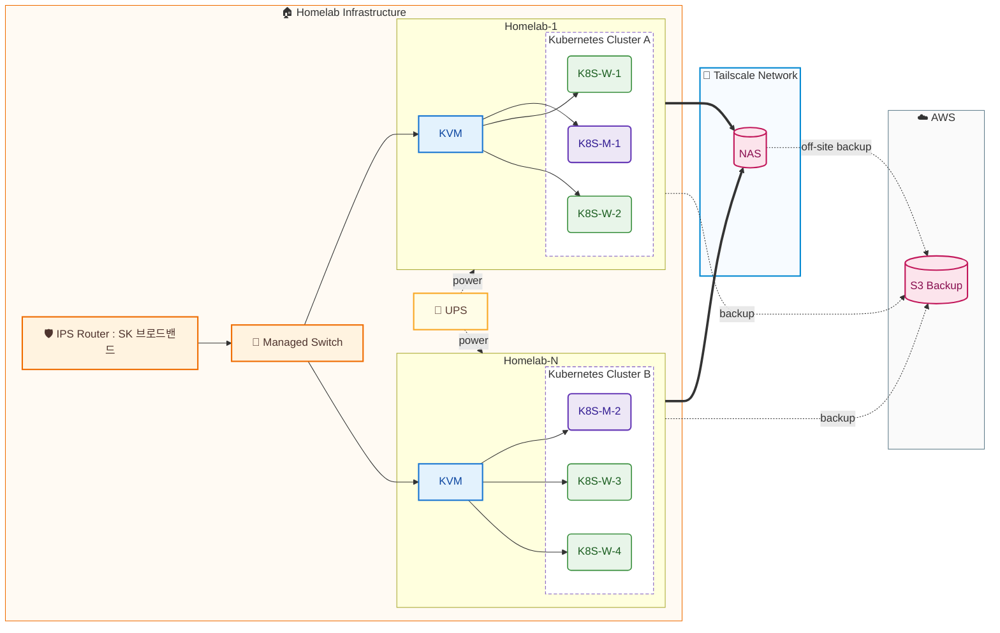
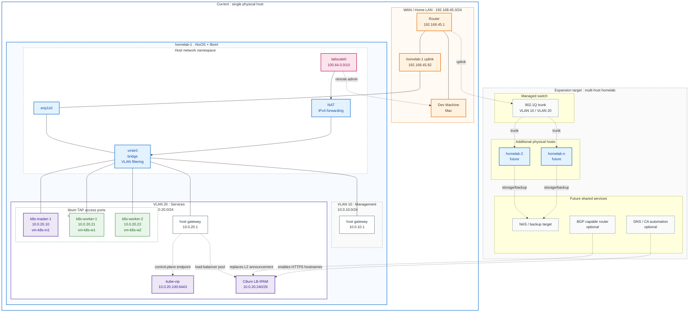
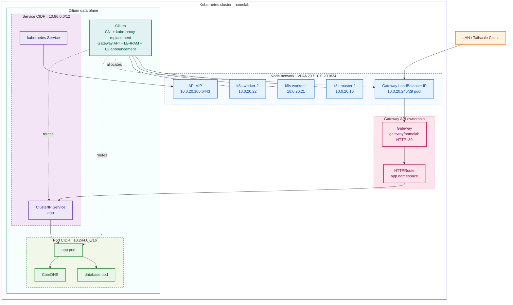

# Hardware Topology

> [!TIP]
>
> 🤷‍♂️🤔 이미 flake 에서 nix-topology 사용 중인데 왜 직접 그리고 앉아있나,,,? 🤔🤷‍♂️

## 확장 설계안 ADR

> [!TIP]
>
> 지금 중요한 것은 설계안이 아니다
> 내가 서버에서 돌릴 서비스와 요구사항이 뭔지 선정의가 필요하다
> 그 다음 하드웨어 스펙과 설계안을 다잡아야한다
>
>  에서는 서버에서 돌아갈 Jellyfin 에 따라
> ADR 과정을 통해 어떤 하드웨어 스펙이 필요하고 왜 특정 하드웨어가 충족을 못 하는지
> 살펴보고 최적의 하드웨어를 찾는다
>
> 이처럼 내가 서버에서 구동할 게 무엇이고
> 내가 원하는 와트수, GPU, CPU, RISC/CISC 인지, 원하는 걸 충족하는지
> 충분히 검토해야한다.

- 랙 : GeeekPi 8U Network Rack [링크](https://www.amazon.com/GeeekPi-Cabinet-Equipment-RackMate-Rackmount/dp/B0FBFDZD4C/ref=sr_1_19?dib=eyJ2IjoiMSJ9.GPy-g2UWXJouAqeMqo5413RKOsIfOEAEv1QkCSZeLWTGjHj071QN20LucGBJIEps.ttQ-rPYfptHFOg3y5G7_x9om6IxNTJt6i978Rcv50_8&dib_tag=se&keywords=raspberry%2Bpi%2Brack&qid=1785222371&sr=8-19&xpid=HQPmUlSCpozj8&th=1)
- UPS : EATON Ellipse ECO 1200 USB DIN 기본 [링크](https://prod.danawa.com/info/?pcode=2722708&keyword=EATON+Ellipse+ECO&cate=112777)
- 관리형 스위치 : 넷기어 GS308E 8포트 [링크](https://smartstore.naver.com/netgearstore/products/4588354776) VS Ubiquiti USW-Ultra [링크](https://store.ui.com/us/en/category/switching-utility/collections/pro-ultra/products/usw-ultra)
- 미니 PC : i5, 16GB, 512GB 이상 매물 올라오면 바로 겟 +) 전력량도 체크해야함

## OPNSense 와 Suricata 추가에 대한 의견 ADR

> [!NOTE]
>
> Snort 와 Suricata 중 왜 Suricata 냐 ?
> 비교분석을 아래와 같이 해본 결과 Suricata 가 Nix Native 하고
> 내 요구사항에 잘 맞아떨어지는 것을 확인할 수 있었다
> 특히 Suricata 는 본인 repo 에서 shell.nix 를 통해 nix pckgs 를 지원하는 반면
> Snort 는 내가 직접 구성해야하는 점이 컸다
>
> | 항목                         | Suricata                                | Snort 3                                      | 네 홈랩에서         |
> | ---------------------------- | --------------------------------------- | -------------------------------------------- | ------------------- |
> | IDS 학습                     | 매우 좋음                               | 매우 좋음                                    | 거의 동급           |
> | Rule 학습                    | Snort 계열 문법                         | 사실상 원조                                  | Snort 약우세        |
> | NixOS native                 | **매우 좋음**                           | 약함                                         | **Suricata 압승**   |
> | 선언형 설정                  | `services.suricata.*`                   | 직접 구성 필요 가능성 높음                   | Suricata            |
> | Rule 업데이트                | `suricata-update`까지 NixOS module 지원 | 별도 구성 부담                               | Suricata            |
> | JSON telemetry               | **EVE JSON 매우 좋음**                  | 지원하지만 생태계가 상대적으로 덜 자연스러움 | Suricata            |
> | Prometheus/Loki/Elastic 연동 | 매우 편함                               | 가능                                         | Suricata            |
> | 멀티스레드                   | 좋음                                    | Snort 3도 좋음                               | 의미 있는 차이 적음 |
> | AF_XDP/eBPF                  | **지원**                                | 구조가 다름                                  | Suricata            |
>
> 주요 차이점에 대해서는 [참고 포스트](https://pswq.tistory.com/619#section-6) 를
> 참고하였다

> [!NOTE]
>
> TL;DR;
> OPNsense 는 추가 X, Suricata 는
>
> 1. 당장은 Homelab-1 에 systemd & monitor stack intergration 형태로 구축
> 2. 추후 확장 시 별도 노드로 처리

이미 network/topology.nix:16에서 VLAN 10/20, VM IP, Kubernetes CIDR을 중앙 선언하고 있고, nodes/
physical/homelab-1.nix:122에서 vlan10, vlan20, NAT, forwarding, bridge를 NixOS가 직접 관리합니다.
Colmena도 lib/mk-colmena.nix:47에서 물리/VM 노드를 같은 선언형 배포 모델로 묶고 있습니다.

Suricata 목적이 IDS, 즉 탐지/알림이면 OPNsense 없이 NixOS host에 바로 붙이는 게 가장
자연스럽습니다. 특히 OPNsense 문서도 NAT 환경에서는 WAN에서 캡처하면 내부 호스트 정보가 NAT 뒤로
사라질 수 있다고 설명합니다. 현재 구성에서는 내부 VLAN 인터페이스인 vlan20이 있으므로
Kubernetes/서비스 VM 트래픽을 NAT 전 위치에서 볼 수 있습니다. 관리망까지 보고 싶으면 vlan10도
추가하면 됩니다. 출처: OPNsense IPS 문서의 인터페이스 선택 설명
https://docs.opnsense.org/manual/ips.html

OPNsense를 고려할 만한 경우는 이럴 때입니다.

- 방화벽/라우터 운영을 NixOS가 아니라 OPNsense GUI 중심으로 바꾸고 싶다.
- NAT, DHCP, VLAN, 방화벽 룰, IDS/IPS 정책을 네트워크 어플라이언스 제품처럼 클릭 기반으로 관리하고 싶다.
- Suricata 룰셋 다운로드/정책/알림 UI가 더 중요하고, 선언형 Nix 관리보다 운영 UI가 우선이다.
- 별도 VM/장비로 라우팅 경계를 분리해서 “NixOS 호스트는 hypervisor, OPNsense는 firewall/router”로 역할을 나누고 싶다.

반대로 지금처럼 Nix가 source of truth라면 OPNsense는 오히려 중복 제어면이 됩니다.
VLAN, NAT, firewall, IDS 정책 일부가 Nix에 있고 일부가 OPNsense config.xml/GUI에 있으면 drift가 생깁니다.
OPNsense는 공식적으로 config 백업/복원을 XML 기반으로 지원하지만, 이 저장소의 Nix/Colmena 모델과
같은 수준의 모듈형 선언형 경계는 아닙니다.

## Network Topology

현재 repo 기준 네트워크 SSoT는 `network/topology.nix`다. 물리 장비는 1대지만, VLAN20 위에
libvirt VM 3대를 올려 Kubernetes 노드를 분리한다.

## Kubernetes Service Network

Kubernetes 내부 네트워크는 물리 VLAN과 별도 CIDR을 쓴다. Cilium이 Pod network와 Service
routing을 담당하고, Gateway API가 앱 HTTPRoute를 shared Gateway에 연결한다.

## Network Address Plan

| 영역            | CIDR/IP           | 역할                              | Source of Truth                            |
| --------------- | ----------------- | --------------------------------- | ------------------------------------------ |
| WAN/Home LAN    | `192.168.45.0/24` | router, Mac, physical host uplink | `network.wan`                              |
| WAN gateway     | `192.168.45.1`    | upstream router                   | `network.wan.gateway`                      |
| homelab-1 WAN   | `192.168.45.82`   | SSH/host uplink                   | `network.wan.host`                         |
| VLAN 10         | `10.0.10.0/24`    | management network                | `network.vlans.management`                 |
| VLAN 10 gateway | `10.0.10.1`       | host-owned gateway                | `network.hosts.homelab-1.vlans.management` |
| VLAN 20         | `10.0.20.0/24`    | Kubernetes node/service network   | `network.vlans.services`                   |
| VLAN 20 gateway | `10.0.20.1`       | host-owned gateway                | `network.hosts.homelab-1.vlans.services`   |
| API VIP         | `10.0.20.100`     | kubeadm controlPlaneEndpoint      | `network.kubernetes.api_vip`               |
| LB pool         | `10.0.20.240/29`  | Cilium LoadBalancer IPPool        | `network.kubernetes.lb_pool`               |
| Pod CIDR        | `10.244.0.0/16`   | Kubernetes Pod network            | `network.kubernetes.pod_cidr`              |
| Service CIDR    | `10.96.0.0/12`    | Kubernetes ClusterIP network      | `network.kubernetes.service_cidr`          |
| Tailscale       | `100.64.0.0/10`   | remote overlay network            | `network.tailscale.network`                |

## Traffic Flows

| Flow                 | Path                                                                                                     |
| -------------------- | -------------------------------------------------------------------------------------------------------- |
| VM outbound internet | VM `10.0.20.x` -> VLAN20 gateway `10.0.20.1` -> `vmbr0` NAT -> router `192.168.45.1`                     |
| Remote admin SSH     | Dev machine -> Tailscale -> `homelab-1` -> ProxyJump -> VM `10.0.20.x`                                   |
| Kubernetes API       | client -> `10.0.20.100:6443` -> kube-vip/control-plane                                                   |
| App HTTP             | client -> Cilium LB IP from `10.0.20.240/29` -> Gateway `gateway/homelab` -> HTTPRoute -> Service -> Pod |
| Pod DNS              | Pod -> CoreDNS Service in `10.96.0.0/12` -> upstream DNS `8.8.8.8`, `1.1.1.1`                            |

## Topology Improvement TODO

| Priority | Area           | Current                                    | Target                                                                     |
| -------- | -------------- | ------------------------------------------ | -------------------------------------------------------------------------- |
| P0       | SSoT           | `network/topology.nix` has current IP plan | Keep topology docs generated/checked against `network/topology.nix`        |
| P0       | App path       | CUE generated app and raw app coexist      | New apps start as raw `deploy/k8s/apps/<app>` until patterns repeat        |
| P1       | Switch         | VLAN intent exists in repo                 | Configure managed switch trunk/access ports explicitly                     |
| P1       | DNS/TLS        | HTTP Gateway + Tailscale access            | Add domain, cert-manager, and external-dns only after hostname count grows |
| P1       | Storage        | local-path on single physical host         | Add backup/restore first; evaluate Longhorn/Ceph after multi-host hardware |
| P2       | Load balancing | Cilium L2 announcement                     | Move to BGP only with router/switch support and multi-host failover tests  |
| P2       | CI/CD          | local `just check` and manual apply        | Re-enable CI first; add CD only after credential boundary ADR              |
| P2       | Expansion      | `homelab-1` only                           | Add `homelab-2` with documented VLAN/IP/failure-domain plan                |
